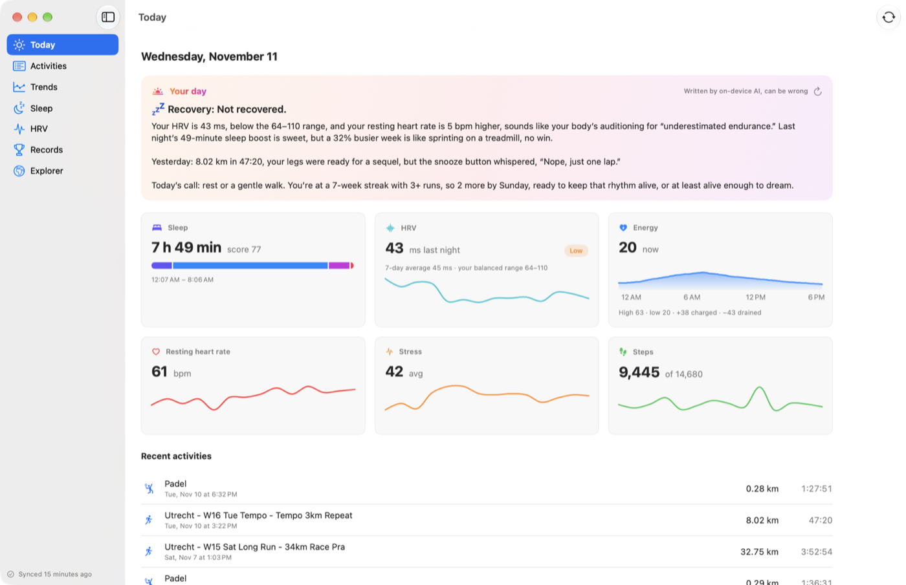
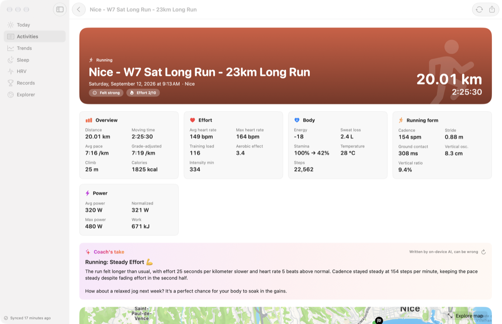
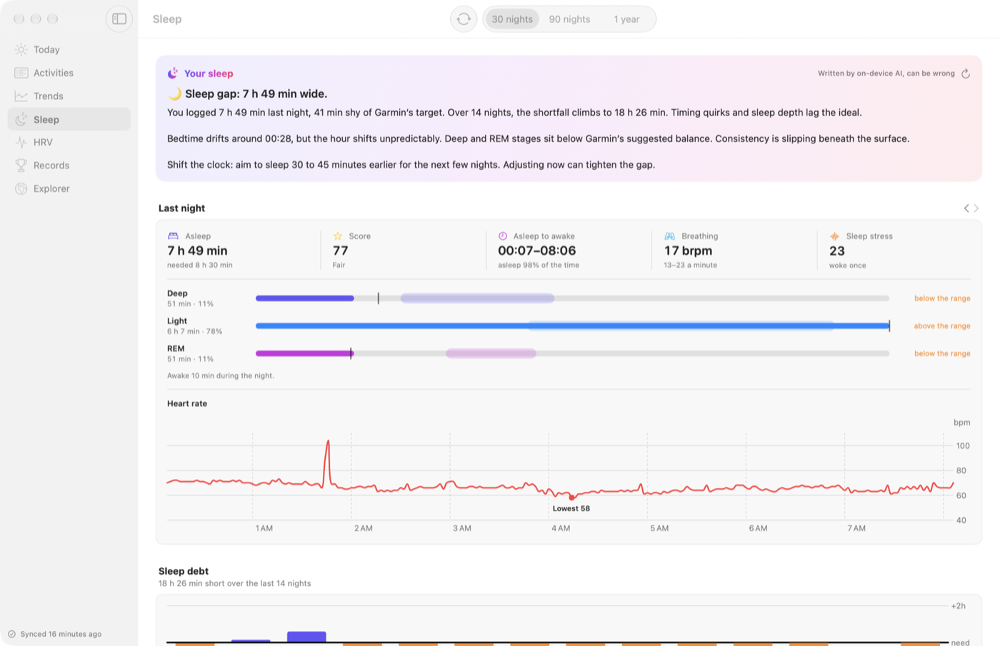
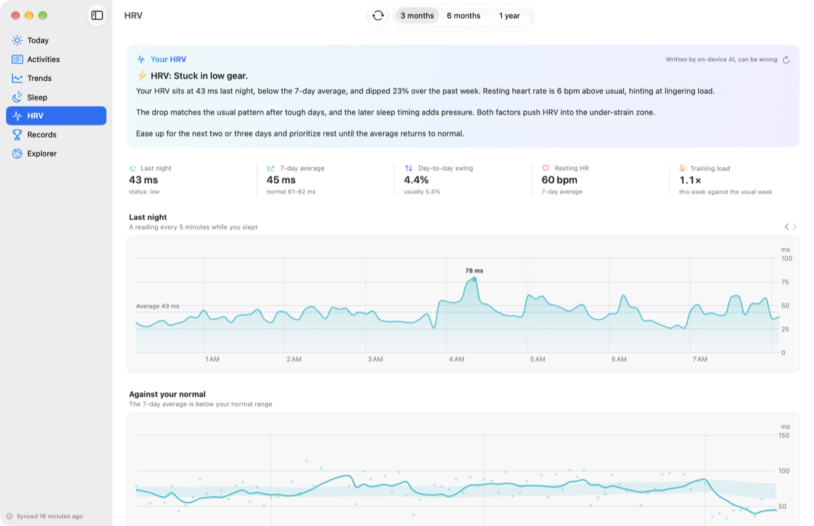
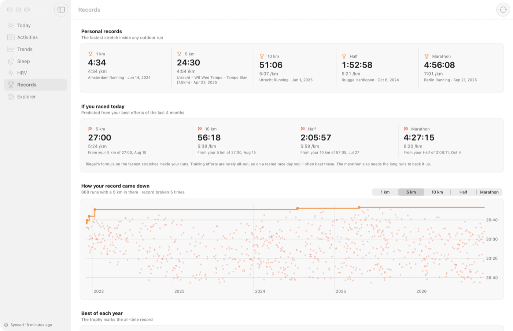
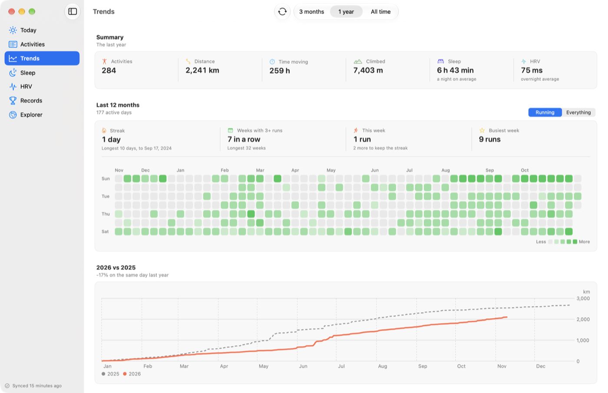
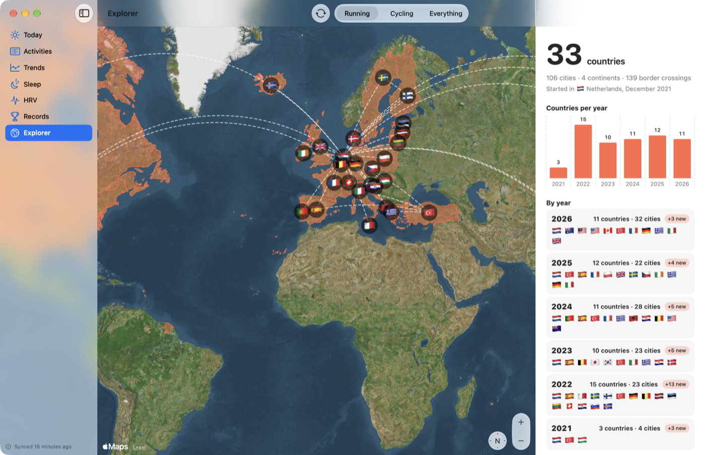

# Splits

Your watch's data, on your Mac. Activities, sleep, HRV, energy and more, in a fast native app. Works with Garmin Connect.

**[splits.bytefabrika.io](https://splits.bytefabrika.io)** · [Download](https://github.com/bytefabrika/splits-mac/releases/latest/download/Splits.zip)

Splits uses the Garmin Connect Personal API with **your own** Personal API key, for your own personal use. The key is kept in your Mac's keychain and only sent to that API; everything Splits downloads stays on your Mac. There's no account, no server and no tracking.



## What's in it
- **Today**: last night's sleep, HRV, energy through the day, resting heart rate, stress and steps, with a short morning briefing written on your Mac by Apple's on-device model.
- **Activities**: every activity in a fast table. Each opens with its route, heart rate, pace and elevation, splits, fastest stretches, zones and a coach's take.
- **Sleep** and **HRV**: last night in detail, your HRV against your own normal range, sleep debt, how regular your nights are and what tends to come before a good or bad morning.
- **Trends** and **Records**: a year of days at a glance, year against year, aerobic form, personal records and race predictions.
- **Explorer**: every country and city you've run in, year by year.
- Menu bar, widgets, a morning notification, and updates through Sparkle.

| | |
|---|---|
|  |  |
|  |  |
|  |  |

## Get started
1. [Download Splits](https://github.com/bytefabrika/splits-mac/releases/latest/download/Splits.zip), unzip it and move Splits to Applications.
2. In Garmin Connect on the web, open **Settings → Personal API Key**, create a key and copy it.
3. Open Splits and paste the key.

Runs on macOS 14 or later (tested on macOS 26 and later); the coach's notes need macOS 26 with Apple Intelligence. Splits checks for updates itself (Settings › General).

## Build from source
```
brew install xcodegen
xcodegen
open Splits.xcodeproj
```

## Data
- Country borders: [Natural Earth](https://www.naturalearthdata.com), public domain.
- Cities: [GeoNames](https://www.geonames.org), licensed under [CC BY 4.0](https://creativecommons.org/licenses/by/4.0/). Bundled in `Splits/Resources/cities.json` (towns of 15,000 people or more; name, country, position, population, province, capital).

Both are bundled, so finding where an activity was never leaves your Mac.

## Legal
Splits is an independent app. It is not made, sponsored, endorsed or approved by Garmin Ltd. or its subsidiaries. Garmin and Garmin Connect are trademarks of Garmin Ltd. or its subsidiaries, named only to say which service Splits works with.

Splits is not a medical device and its numbers and AI-written notes are not medical advice. It is provided as is, without warranty, under the [MIT License](LICENSE). Full notices: [LEGAL.md](LEGAL.md).
